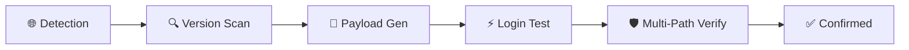

<div align="center">

# 🎯 JoomlaChecker — Joomla Admin Login Checker

### 🚀 ULTIMATE EDITION v9.0 — Multi-Version · Multi-Payload · Multi-Path

<!-- MAIN BANNER -->
<p align="center">
  
</p>

<!-- BADGES -->
<p align="center">
  
  
  
  
  
  
</p>

<!-- STATS -->
<p align="center">
  
  
  
  
</p>

<!-- DESCRIPTION -->
<h3>
  ⚡ 100% Automated — Detection → Version Scan → Multi-Payload → Verification
</h3>

</div>

---

## 📖 Table of Contents

- [📌 Description](#-description)
- [📸 Live Demo](#-live-demo)
- [🔍 How It Works](#-how-it-works)
- [⚙️ Installation](#️-installation)
- [🚀 Usage](#-usage)
- [🧩 Version Support](#-version-support)
- [📱 Contact](#-contact)
- [⚠️ Disclaimer](#️-disclaimer)

---

## 📌 Description

<div align="center">

### Ultimate Joomla Admin Login Checker

**JoomlaChecker** is an advanced tool that automatically detects Joomla versions and tries **7 different payloads** per credential against **5-6 protected paths** — with strict anti-false-positive logic.



</div>

### ✨ Key Features

| Feature | Description | Status |
|---------|-------------|--------|
| 🔍 Auto Detection | Detects Joomla version (1.0 → 5.x) | ✅ |
| 🧬 Multi-Payload | 7 payloads generated per credential | ✅ |
| 🛡️ Multi-Path Verify | Checks 5-6 protected paths | ✅ |
| 🍪 Version-Aware Cookies | `jos_session` vs `joomla_user_state` | ✅ |
| 📡 Version-Aware Paths | `index2.php` vs `index.php` | ✅ |
| ⚡ Multi-Threading | 10 parallel workers by default | ✅ |
| 🎯 Anti-False-Positive | Adaptive marker threshold | ✅ |

---

## 📸 Live Demo

<div align="center">

### 🖥️ Terminal — Tool Launch

<p align="center">
  
</p>

### 🎯 Terminal — Results Found

<p align="center">
  
</p>

### 🌐 Joomla Panel — Found by the Tool

<p align="center">
  
</p>

</div>

---

## 🔍 How It Works

<div align="center">

| Property | Value |
|-----------|--------|
| **Tool Name** | JoomlaChecker |
| **Version** | 9.0 ULTIMATE |
| **Type** | Admin Login Checker |
| **Target** | Joomla CMS |
| **Supported Versions** | 1.0 → 5.x |
| **Payloads per Credential** | 7 |
| **Protected Paths Verified** | 5-6 |

</div>

### 📋 Exploitation Flow

```
1. Version Detection
   ↓
2. Locate Login Form
   ↓
3. Extract CSRF Token
   ↓
4. Generate 7 Payloads
   ↓
5. Test Each Payload
   ↓
6. Verify on Protected Paths
   ↓
7. Verdict (REAL / FAIL)
```

### 🧬 Payloads Tried

| # | Payload | Target Version |
|---|---------|----------------|
| 1 | `username` + `passwd` + `com_login` | 1.5 – 3.x |
| 2 | `username` + `password` + `com_login` | 4.x – 5.x |
| 3 | `username` + `passwd` + `com_user` | 1.5 legacy |
| 4 | `user` + `pass` + `submit` | 1.0 |
| 5 | `username` + `passwd` + `submit` | 1.0 hybrid |
| 6 | `username` + `passwd` + `password` | Unknown |
| 7 | `username` + `passwd` + `return` | 1.5 base64 |

---

## ⚙️ Installation

<div align="center">

### Prerequisites

| Dependency | Version | Installation |
|-----------|---------|--------------|
| Python | 3.8+ | [python.org](https://python.org) |
| requests | 2.28+ | `pip install requests` |
| urllib3 | 1.26+ | `pip install urllib3` |
| colorama | 0.4+ | `pip install colorama` |

</div>

```bash
# 1. Clone the repository
git clone https://github.com/HackfutSecRoot/JoomlaChecker.git
cd JoomlaChecker

# 2. Install dependencies
pip install requests urllib3 colorama

# 3. Run the tool
python3 joomla_checker.py
```

---

## 🚀 Usage

### 🎯 Single Input File

```bash
# Launch the tool
python3 joomla_checker.py

# Then enter the file path:
Give me your file: targets.txt
```

### 📝 targets.txt Format

```txt
# Joomla Targets — Format: URL#USERNAME@PASSWORD
https://site1.com#admin@password123
https://site2.com/joomla#administrator@pass456
https://site3.com#root@toor
# Comments start with #
```

### 📊 Output Files

| File | Content |
|------|---------|
| 🟢 `successful_logins.txt` | Confirmed logins with version + payload |
| 🔴 `failed_logins.txt` | Failed logins with reason |

### 🔧 All Options

```bash
Options:
  MAX_THREADS          Threads (default: 10)
  SUCCESS_FILE         Success output (default: successful_logins.txt)
  FAILED_FILE          Failed output (default: failed_logins.txt)
```

---

## 🧩 Version Support

<div align="center">

| Version | Login Path | Cookie | Payload |
|---------|-----------|--------|---------|
| **1.0** | `index2.php` | `sessioncookie` / `mos_*` | `user` + `pass` |
| **1.5** | `index2.php` | `jos_session` | `username` + `passwd` |
| **1.6 / 1.7** | `index.php` | `jos_session` | `username` + `passwd` |
| **2.5** | `index.php` | `jos_session` | `username` + `passwd` |
| **3.x** | `index.php` | `joomla_user_state` | `username` + `passwd` |
| **4.x** | `index.php` | `joomla_user_state` | `username` + `password` |
| **5.x** | `index.php` | `joomla_user_state` | `username` + `password` |

</div>

### 🛡️ Verified Protected Paths

```yaml
Modern (3.x → 5.x):
  - /administrator/index.php?option=com_users&view=users
  - /administrator/index.php?option=com_config
  - /administrator/index.php?option=com_users&task=view
  - /administrator/index.php?option=com_content
  - /administrator/index.php?option=com_media

Legacy (1.0 / 1.5):
  - /administrator/index2.php?option=com_content
  - /administrator/index2.php?option=com_users
  - /administrator/index2.php?option=com_admin
```

---

## 📱 Contact

<div align="center">

### Join Us on Telegram

| Channel | Link | Description |
|---------|------|-------------|
| 📢 **Channel 1** | [t.me/+gsrpvshwGUc5MzI0](https://t.me/+gsrpvshwGUc5MzI0) | Main Channel |
| 🔥 **Channel 2** | [t.me/LinxProdXs404](https://t.me/LinxProdXs404) | LinxProdXs404 |
| 💀 **ULP** | [t.me/ulp_CLOUD1](https://t.me/ulp_CLOUD1) | ULP Channel |
| 📌 **Post #249** | [t.me/LinxProdXs404/249](https://t.me/LinxProdXs404/249) | Important Post |
| 🎯 **Post #541** | [t.me/LinxProdXs404/541](https://t.me/LinxProdXs404/541) | Featured Post |
| 📋 **Pastebin** | [pastebin.com/u/hackfut](https://pastebin.com/u/hackfut) | Code Snippets |
| 💬 **DM** | [@HackfutS3c](https://t.me/HackfutS3c) | Direct Contact |

</div>

---

## ⚠️ Disclaimer

<div align="center">

### ⚠️ LEGAL WARNING ⚠️

<p align="center">
  
</p>

> **This tool is intended for EDUCATIONAL and AUTHORIZED security testing purposes ONLY.**
>
> Using this tool against systems without explicit authorization is **ILLEGAL**.
>
> The author is not responsible for any malicious or illegal use of this tool.
>
> Only use it on systems you own or for which you have written permission to test.

</div>

---

## 📄 License

<div align="center">

```
MIT License

Copyright (c) 2024 HackfutSec

Permission is hereby granted, free of charge, to any person obtaining a copy
of this software and associated documentation files (the "Software"), to deal
in the Software without restriction, including without limitation the rights
to use, copy, modify, merge, publish, distribute, sublicense, and/or sell
copies of the Software, and to permit persons to whom the Software is
furnished to do so, subject to the following conditions:

The above copyright notice and this permission notice shall be included in all
copies or substantial portions of the Software.

THE SOFTWARE IS PROVIDED "AS IS", WITHOUT WARRANTY OF ANY KIND, EXPRESS OR
IMPLIED, INCLUDING BUT NOT LIMITED TO THE WARRANTIES OF MERCHANTABILITY,
FITNESS FOR A PARTICULAR PURPOSE AND NONINFRINGEMENT. IN NO EVENT SHALL THE
AUTHORS OR COPYRIGHT HOLDERS BE LIABLE FOR ANY CLAIM, DAMAGES OR OTHER
LIABILITY, WHETHER IN AN ACTION OF CONTRACT, TORT OR OTHERWISE, ARISING FROM,
OUT OF OR IN CONNECTION WITH THE SOFTWARE OR THE USE OR OTHER DEALINGS IN THE
SOFTWARE.
```

</div>

---

## 🏆 Credits

<div align="center">

| Contributor | Role |
|-------------|------|
| **HackfutSec** | Lead Developer |
| **LinxProdXs404** | Support & Testing |
| **ULP Team** | Resources |

### ⭐ If this tool was helpful, don't forget to leave a star!

<p align="center">
  <a href="https://github.com/HackfutSecRoot/JoomlaChecker">
    
  </a>
  <a href="https://github.com/HackfutSecRoot/JoomlaChecker/fork">
    
  </a>
  <a href="https://github.com/HackfutSecRoot/JoomlaChecker/subscription">
    
  </a>
</p>

</div>

---

<div align="center">

### 🔥 HackfutSec — Security is just an illusion 🔥


</div>
